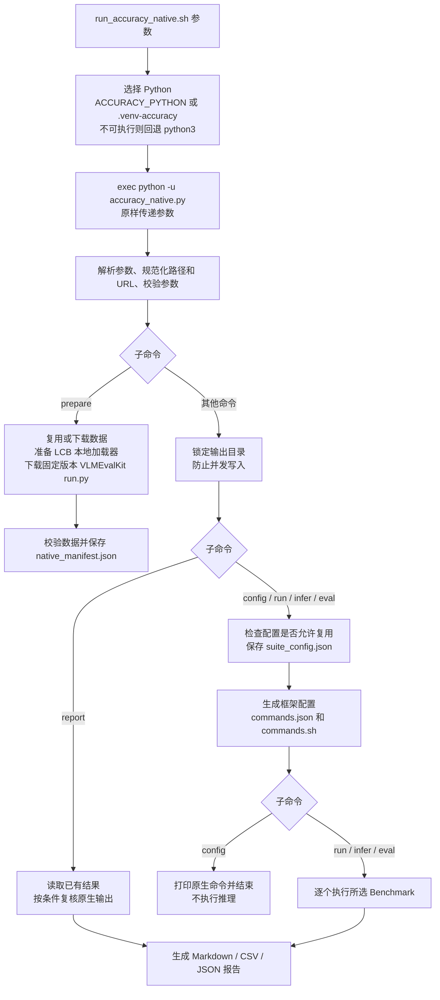
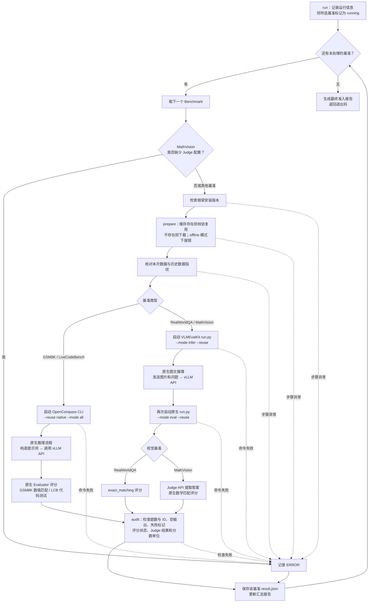

# 原生精度评测脚本调用流程

[run_accuracy_native.sh](../scripts/run_accuracy_native.sh) 负责选择 Python 并转发参数，主要调度逻辑位于 [accuracy_native.py](../scripts/accuracy_native.py) 的 `main()`。安装和使用方法见 [原生评测说明](accuracy-native.md)。

## 入口与子命令分支

参数无效、无法取得目录锁或整体配置不兼容时，会结束本次调用并返回错误；这些检查发生在逐项评测循环之前。

## run 完整执行流程

不同 Benchmark 按顺序运行；单个 Benchmark 内部的请求并发由原生框架管理。外层脚本通过 `execute()` 启动原生命令，不自行发送模型推理请求或计算基准分数。

图中的推理、评分节点表示原生框架的职责；已有有效缓存时，框架可按 `--reuse` 规则跳过已完成工作。逐项循环内捕获的异常会保存为该项 `ERROR`，然后继续其他基准；手动中断则结束整个运行。

## 子命令与输出

| 命令 | 实际行为 |
|---|---|
| `prepare` | 下载或复用数据，准备本地加载器及原生入口，不执行推理 |
| `config` | 生成具体配置、`commands.json` 和可执行的 `commands.sh`，不执行推理 |
| `run` | 推理、评分、完整性检查及准入报告 |
| `infer` | 只运行原生推理，成功标记为 `inferred`，不判定准入通过 |
| `eval` | 使用已有预测运行原生评分，再检查结果并生成准入报告 |
| `report` | 读取已有结果并按条件复核原生输出，重新汇总，不发起推理或评分 |

`report` 不会仅凭旧输出将已记录为 `error` 或 `running` 的任务改为通过；这类任务需要通过 `run` / `eval` 恢复。

输出目录顶层保存 `summary.md`、`summary.csv`、`summary.json`；原生工作目录分别位于 `opencompass/<benchmark>/native/` 和 `vlmeval/<benchmark>/q38/T*/`。四项完整且分别达到 95.0、88.3、83.9、88.0，整体判定才为 `PASS`。

| 退出码 | 含义 |
|---|---|
| `0` | 完整评测四项全部通过；或 `prepare`、`config`、所选项的 `infer` 成功 |
| `1` | 四项评分完成，但存在精度不达标 |
| `2` | 参数、配置或执行错误，或完整评测存在缺项 |
| `130` | 手动中断 |

`infer` 返回 0 仅表示推理阶段成功，准入报告仍为 `INCOMPLETE`。
